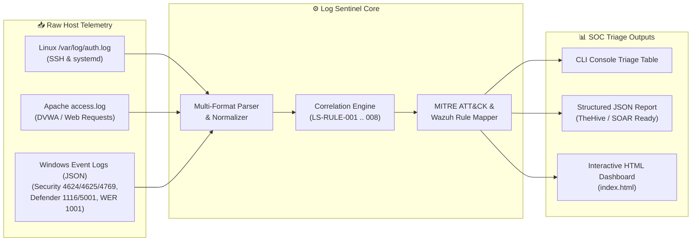

<div align="center">

# 🔍 Log Sentinel v1.2.0
### **Zero-Dependency Python Threat Detection & SOC L1/L2 Incident Triage Engine**

[](https://github.com/Voobrazhenie21-lab/log-sentinel/actions)
[](https://voobrazhenie21-lab.github.io/log-sentinel/)
[](https://www.python.org/)
[](https://attack.mitre.org/)
[](https://wazuh.com/)

<p align="center">
  <b>Automated correlation of Linux <code>auth.log</code>, Apache <code>access.log</code>, and Windows Security / Defender / WER Event Logs into actionable SOC L1/L2 alerts with MITRE ATT&amp;CK mapping and Wazuh SIEM rule parity.</b>
</p>

[🌐 **View Live Interactive SOC Triage Dashboard**](https://voobrazhenie21-lab.github.io/log-sentinel/) &bull; [🛡️ **Related DFIR Case Study (`acme.skb`)**](https://github.com/Voobrazhenie21-lab/blue-team-incident-investigation)

</div>

---

## 🎯 Overview & Purpose

During **Level 1 / Level 2 SOC alert triage** and **Digital Forensics & Incident Response (DFIR)**, analysts frequently need to correlate disparate host logs (Linux SSH/systemd, Apache web access logs, and Windows Security/Defender/WER events) without waiting for heavy SIEM indexing.

**Log Sentinel** is a lightweight, **zero-external-dependency** Python CLI engine designed to:
1. **Normalize** multi-platform telemetry (`Linux auth.log`, `Apache access.log`, `Windows Event JSON/JSONL`) into a unified schema.
2. **Correlate** multi-stage attack patterns across **8 high-fidelity detection rules** modeled on real-world enterprise compromises (including the `acme.skb` Active Directory & DMZ breach).
3. **Export** structured **JSON** incident reports (for SOAR/TheHive ingestion) and standalone **Dark-Mode Interactive HTML Dashboards** with forensic evidence chains and remediation playbooks.

---

## 🏗️ Architecture & Detection Pipeline



---

## 🛡️ Built-In Detection Rules & MITRE ATT&CK Matrix

| Rule ID | Alert Title | Telemetry Source | MITRE ATT&CK | Wazuh Rule Parity | Severity |
|:---|:---|:---|:---|:---|:---|
| **`LS-RULE-001`** | **Web Shell Upload & Execution** (`backdoor.php` in `/uploads/`) | Apache `access.log` | `T1505.003` (Web Shell) | Rule `31106` / `550` | 🔴 **CRITICAL** |
| **`LS-RULE-002`** | **SSH Brute-Force Followed by Successful Login / Key Injection** | Linux `auth.log` | `T1110.001` / `T1098.004` | Rule `5712` / `5720` | 🔴 **CRITICAL** |
| **`LS-RULE-003`** | **Windows RDP/Network Brute-Force Attack** (`4625` $\rightarrow$ `4624`) | Windows Security (`4625`/`4624`) | `T1110.001` / `T1021.001` | Rule `60204` | 🔴 **CRITICAL** |
| **`LS-RULE-004`** | **Kerberoasting Service Ticket Downgrade** (`RC4-HMAC 0x17`) | Windows Security (`4769`) | `T1558.003` (Kerberoasting) | Rule `60115` | 🟠 **HIGH** |
| **`LS-RULE-005`** | **Pass-the-Hash (PtH) Lateral Movement** (`LogonType 3, NtLmSsp, KeyLen 0`) | Windows Security (`4624`) | `T1550.002` (Pass the Hash) | Rule `92652` | 🔴 **CRITICAL** |
| **`LS-RULE-006`** | **Endpoint Defense Tampering** (Defender Disabled / Wazuh Stopped) | Defender (`5001`/`5007`) + `syslog` | `T1562.001` (Impair Defenses) | Rule `62152` / `506` | 🔴 **CRITICAL** |
| **`LS-RULE-007`** | **Forensic WER AppCrash of Deleted LPE Exploit** (`CVE-2019-0623.exe`) | Windows WER (`EventID 1001`) | `T1068` / `T1070.004` | Forensic WER Artifact | 🟠 **HIGH** |
| **`LS-RULE-008`** | **Malware / Mimikatz Execution via Redirected RDP Drive (`\\tsclient`)** | Defender (`1116`/`1117`) | `T1003.001` / `T1021.001` | Rule `62123` | 🔴 **CRITICAL** |

---

## 🚀 Quick Start

### 1. Clone & Run (Zero External Dependencies!)

Because **Log Sentinel** is built strictly on the Python 3.9+ Standard Library, it runs out-of-the-box on any air-gapped forensic workstation or incident response jumpbox:

```bash
git clone https://github.com/Voobrazhenie21-lab/log-sentinel.git
cd log-sentinel

# Run analysis against the bundled acme.skb incident logs
python -m log_sentinel analyze samples/ --json-out samples/sample_report.json --html-out index.html
```

### 2. Sample CLI Output

```text
==============================================================================
🔍 LOG SENTINEL v1.2.0 — SOC L1/L2 THREAT DETECTION & TRIAGE REPORT
==============================================================================
Total Normalized Events Parsed : 27
Total Correlated Alerts Fired  : 8
------------------------------------------------------------------------------
[1] [CRITICAL] LS-RULE-001: Web Shell Upload & Execution Detected (DVWA / Unrestricted Upload)
    Host / Source IP : web-server <- 10.0.10.254 (User: root / www-data)
    MITRE ATT&CK     : Persistence / Initial Access | T1505.003 (Server Software Component: Web Shell)
    Wazuh Equivalent : Wazuh Rule 31106 / 550 (FIM Webshell)
    Time Window      : 18/Apr/2023:12:43:00 +0000 -> 18/Apr/2023:12:51:40 +0000 (3 events)
------------------------------------------------------------------------------
[5] [CRITICAL] LS-RULE-005: Pass-the-Hash (PtH) Lateral Movement Detected (Event ID 4624 NTLM)
    Host / Source IP : dc01.acme.skb <- 10.0.30.53 (User: domainadmin)
    MITRE ATT&CK     : Lateral Movement / Defense Evasion | T1550.002 (Use Alternate Authentication Material: Pass the Hash)
    Wazuh Equivalent : Wazuh Rule 92652 (Pass-the-Hash Activity)
    Time Window      : 2023-04-19T09:34:29Z -> 2023-04-19T09:34:29Z (1 events)
------------------------------------------------------------------------------
```

### 3. Run Unit Tests

```bash
pip install -e ".[dev]"
pytest -v
```

---

## 📂 Repository Structure

```text
log-sentinel/
├── log_sentinel/
│   ├── __init__.py          # Package metadata
│   ├── __main__.py          # CLI entry point (python -m log_sentinel)
│   ├── cli.py               # Argument parser and workflow orchestration
│   ├── models.py            # NormalizedEvent and Alert dataclasses
│   ├── parsers.py           # Regex & JSON parsers for Linux, Apache, and Windows logs
│   ├── engine.py            # 8 SOC correlation rules & MITRE ATT&CK mapping
│   └── reporter.py          # Console, JSON, and Dark-Mode HTML Dashboard generators
├── samples/                 # Real-world forensic log dataset (modeled on acme.skb incident)
│   ├── apache_access.log
│   ├── linux_auth.log
│   ├── windows_security_events.json
│   └── sample_report.json
├── tests/
│   └── test_log_sentinel.py # Automated Pytest suite
├── index.html               # Pre-rendered Interactive SOC Dashboard for GitHub Pages
└── pyproject.toml           # PEP 621 packaging configuration
```

---

## 🗺️ Roadmap & Evolution (`v1.0` $\rightarrow$ `v1.2.0`)

- [x] **Pass-the-Hash Detection (`Event ID 4624`, LogonType 3, `NtLmSsp`, `KeyLength=0`)** — *Implemented in `v1.2.0` (`LS-RULE-005`, Wazuh Rule `92652` parity)*
- [x] **Automated Unit Tests (`pytest`) & GitHub Actions CI Matrix (Python 3.10–3.13)** — *Implemented in `v1.2.0`*
- [x] **Web Shell Upload (`backdoor.php`), `WER AppCrash` (`Event ID 1001`), and `\\tsclient` RDP Share Forensics** — *Implemented in `v1.2.0` (`LS-RULE-001`, `007`, `008`)*
- [x] **Interactive Dark-Mode HTML SOC Triage Dashboard & Multi-Format Support (CSV + JSON + Logs)** — *Implemented in `v1.2.0`*
- [ ] **AS-REP Roasting Detection (`Event ID 4768`)** — *Planned for `v1.3`*
- [ ] **Sysmon Telemetry Support (`Event ID 1, 3, 10 — LSASS Process Access`)** — *Planned for `v1.3`*

---

## 👨‍💻 Author

**Aleksei Zharkou** — Cybersecurity Specialist (Blue Team / SOC L1-L2 / DFIR / Pentesting)  
- 🔗 **LinkedIn:** [linkedin.com/in/aleksei-zharkou](https://www.linkedin.com/in/aleksei-zharkou)  
- 💬 **Telegram:** [@Voobrazhenie_20](https://t.me/Voobrazhenie_20)  
- 🐙 **GitHub Portfolio:** [github.com/Voobrazhenie21-lab](https://github.com/Voobrazhenie21-lab)

